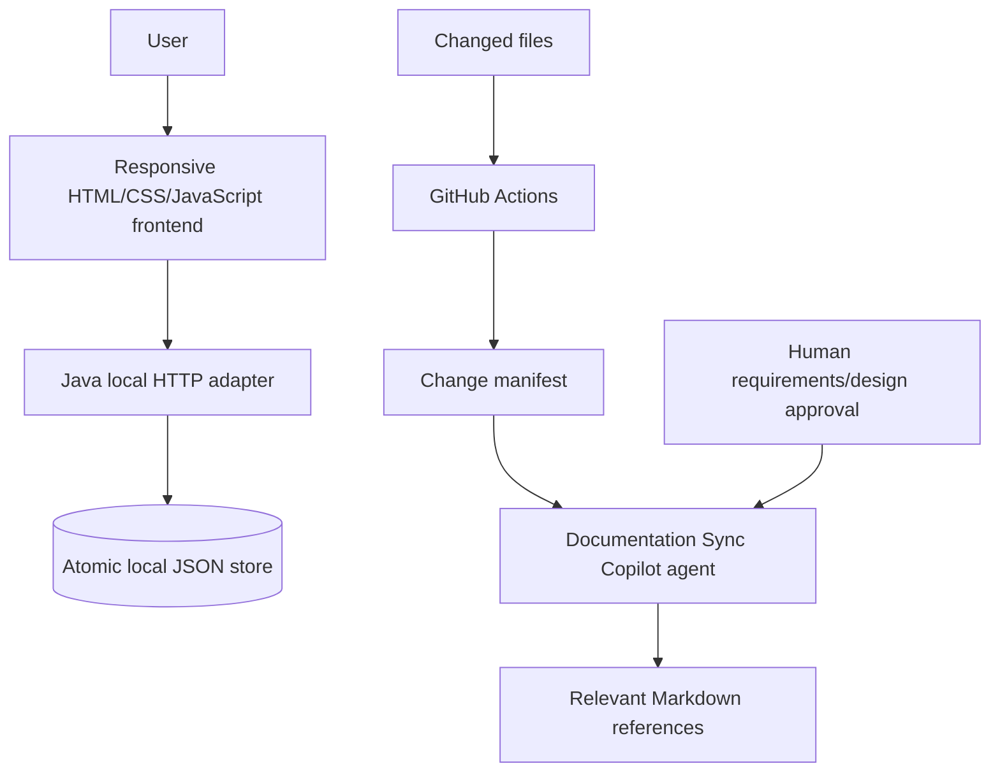
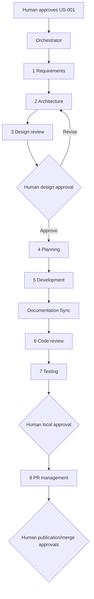

# Architecture - Daily Expense Tracker

US-001 preserves the responsive HTML/CSS/JavaScript frontend. A
dependency-free Java HTTP adapter provides the local CRUD API and atomically
persists runtime records as ignored JSON because no SQLite driver is included.

## Documentation flow

GitHub Actions compares the base revision with the current revision and records
added, modified and deleted paths in `changed-files.txt`. It validates the
custom-agent, instruction, skill, prompt and hook configuration and runs the
optional frontend regression test. The Documentation Sync agent consumes the
manifest, classifies functionality changes, and updates only the affected
sections of the API, architecture, UI, README, test-plan and changelog docs.

Requirements and design decisions remain human gates. Agents do not invent
scope, evidence, approvals, commits or publication status. Unrelated handwritten
Markdown is preserved.

## Components and contracts

| Component | Responsibility |
|---|---|
| `src/static` | Preserved dependency-free responsive frontend |
| `src/web.java` | Loopback Java HTTP server, static assets and expense CRUD API |
| `expenses-java.json` | Atomic local runtime data, excluded from Git |
| `.github/agents` | Orchestrator plus nine specialist agents |
| `.github/instructions` | Scoped repository and documentation rules |
| `.github/skills` | Reusable synchronization and verification procedures |
| `.github/prompts` | Bounded workflow entry points |
| `.github/hooks/docsync.json` | Supported changed-file hook integration |
| `.github/workflows/documentation-sync.yml` | Detection, validation, artifact publication and PR reminder |
| `docs/*.md`, `README.md`, `CHANGELOG.md` | Human and agent-maintained documentation |

## Preserved agentic SDLC

The Orchestrator routes bounded work and stops at denied or missing gates.
Documentation Sync is the sole owner of `docs/api.md`; it may update other
documents only when the change manifest shows they are relevant.
