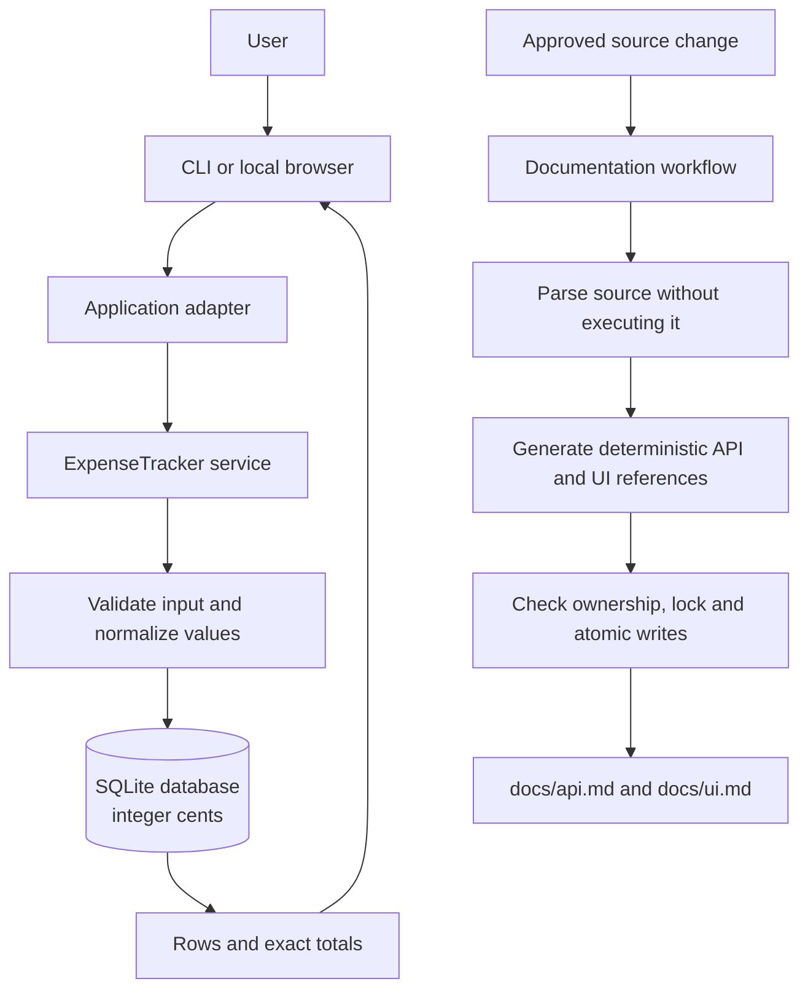
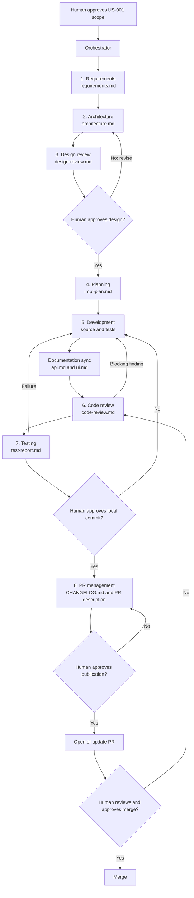

# Architecture - Daily Expense Tracker

Python 3.11+ standard library: `ast`, `pathlib`, `hashlib`, `tempfile`, `os`,
`argparse`, `threading`, `json`, `subprocess`, `sqlite3`, `decimal`, `datetime`,
`dataclasses` and `unittest`. No runtime packages.

The runtime path is deliberately top-down: a user chooses an interface, the
adapter calls one reusable service, the service validates data, and SQLite
stores the result. The documentation path is separate: an approved source
change is parsed, rendered and checked before generated references are replaced.
This keeps application behavior and documentation automation explainable without
requiring a hidden background service or agent runtime.

## Explainable agentic workflow

The agents do not independently invent scope or publish changes. The
Orchestrator moves one human-approved US-001 through a fixed sequence. Each
specialist has one job, produces a named artifact, and hands that artifact to
the next stage. A human gate is required whenever scope, implementation,
publication or merge authority changes.

At every handoff the Orchestrator can answer four questions: what was approved,
which agent acted, which artifact was produced, and what gate is next. A failed
review or test returns the work to Development; it does not silently advance.
Documentation Sync is a deterministic tool step inside Development, not an
autonomous decision-maker. PR Management can prepare or update a PR only after
the separate human publication approval.

## Components and contracts
| Component | Responsibility |
|---|---|
| `src/expenses.py` | CLI, validated expense service, SQLite persistence, category filters and totals |
| `src/web.py` | Loopback HTTP/static adapter; reuse service, exact filtered dashboard summaries, JSON CRUD |
| `src/static` | Accessible responsive HTML/CSS/vanilla JavaScript dashboard, forms, charts and filters |
| `src/docsync.py` | Snapshot safe source paths, render public APIs, sync/check/watch |
| `src/ui_docs.py` | Non-executing HTML metadata, CSS selectors, JS declaration/explicit prose inventory |
| `src/copilot_hook.py` | Validate hook JSON; request approval for every non-read tool; run sync |
| `src/git_gate.py` | Read staged Git blobs into a temporary workspace and check their docs |
| `.github/hooks` | VS Code lifecycle configuration and opt-in Git pre-commit entry point |
| `tests` | Isolated unit/integration and customization contract tests |
| `docs/api.md`, `docs/ui.md` | Fully generated, owned references; all other docs are handwritten |

## Expense application
`python src\expenses.py [--database PATH] COMMAND` separates argument parsing from
the reusable `ExpenseTracker` service. A frozen `Expense` record carries ID,
integer cents, normalized category, description and ISO date. The default database
is `expenses.sqlite3` at the repository root; `--database` selects another existing
directory's file. There are no imports or side effects from running the CLI during
AST documentation generation.

SQLite schema: `expenses(id INTEGER PRIMARY KEY AUTOINCREMENT, amount_cents INTEGER,
category TEXT, description TEXT, date TEXT)`. IDs are never reused after deletion.
Amounts are positive, at most 99,999,999,999 cents; Decimal validates decimal strings
before conversion. Currency formatting uses integer division, not floats.
Category keys use Python strip/casefold for exact Unicode-aware comparison.
Dates must round-trip through `date.fromisoformat` as `YYYY-MM-DD`.

Every operation opens and closes its own connection; mutations commit or roll
back as one transaction. Updates use a single SQL statement with validated fields,
so concurrent updates do not overwrite unspecified fields. SQL parameters carry
all values; only fixed allowlisted column names form update clauses. Totals sum
integer cents in Python to avoid SQLite aggregate integer overflow. Queries sort
by date then ID. Missing records raise `ExpenseError`; invalid inputs do not mutate
data. The CLI reports validation/SQLite/filesystem errors on stderr and exits 2.
Database creation/open errors are never treated as an empty tracker.
SQLite serializes writers with its default timeout; lock errors surface explicitly.
No custom migration framework, background service or third-party ORM is needed.

## Website and local JSON adapter
`python src\web.py [--database PATH] [--port PORT]` serves a fixed asset allowlist
from `src/static`, binds only `127.0.0.1` and uses `ThreadingHTTPServer`.
Each expense operation still opens its own transactional SQLite connection via
the original service. No schema migration or existing database rewrite is performed.
GET `/api/expenses` reads one service snapshot and applies month/category filters
for consistent records, totals and chart series. Category validation reuses the
service helper. JSON IDs and monetary values are strings; JavaScript uses BigInt
for money, averages and ratios, converting only bounded chart percentages to Number.

The browser uses textContent, not user-provided HTML. Native modal dialogs provide
keyboard handling and confirmation; errors remain explicit and forms retain values.
All chart values have accessible text/labels. Filter request versions prevent stale
responses overwriting newer results. Host/Origin validation and a custom mutation
header prevent cross-site writes without adding accounts; no CORS is enabled.
Responses carry CSP/no-sniff/no-store headers. Requests accept only allowlisted
string fields and bounded UTF-8 JSON. This is local single-user software, not a
production security boundary or public HTTP deployment.

## Preserved documentation infrastructure

Content fingerprint covers sorted relative paths and raw file bytes, even comments.
Python and frontend inputs have independent fingerprints and generated outputs.
Only top-level public declarations and direct public class methods are indexed;
constructors are included. Parameter kinds are preserved, defaults become `...`.
Docstrings are HTML-escaped; signatures use escaped code markup. Missing descriptions
are `Not Found`. UTF-8 source and Python encoding-cookie files are parsed by AST.

Output has an exact ownership marker; foreign files are never overwritten.
The engine rejects source/output symlinks and non-regular source files. It snapshots
before rendering and checks source stability before writing. Cooperating sync writers
use an exclusive workspace lock, then fsync and replace a same-directory temporary file.
An interrupted process may leave a lock: inspect its recorded PID before manual removal.
The filesystem is trusted against hostile concurrent swaps; this is not a sandbox.

Watch polls recursively, reports errors and retains good output, then recovers on a
subsequent valid source edit. Stop with Ctrl+C. Hook execution is local and bounded.
Pre-commit validates the Git index, not just the working tree, so partial staging
cannot hide drift. It does not modify the index or auto-stage files.
The same source snapshot includes nested HTML/CSS/JS, and the gate copies both
generated references. UTF-8 frontend inventories use HTMLParser, conservative
CSS/JS declaration matching, HTML data-component/data-doc metadata and JS @ui
comments. They are not full CSS/JS grammar validation or runtime inference.
Removing the last frontend source clears an existing generated UI inventory.
Python-only projects do not require a UI reference. Both outputs are rendered
and ownership-checked before any write, then replaced atomically per file under
one lock. Cross-file replacement is not a filesystem transaction: a replacement
failure can leave one stale output, diagnosed by check and repaired by sync.
