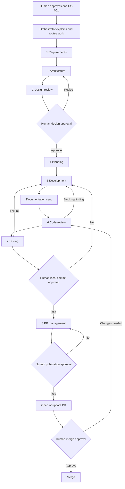

# Eight-stage top-down workflow

This is a top-down, explainable workflow rather than a collection of
autonomous agents. The Orchestrator is the coordinator, not the decision-maker:
it reads the current artifact, sends a bounded task to the next specialist and
records the handoff. Specialists do not skip gates, broaden US-001 or publish
remotely on their own.

| Stage | Execution / artifact | Gate |
|---|---|---|
| 1 Requirements | Clarify supplied document into requirements.md; commit checkpoint when Git exists | Human source language and scope |
| 2 Architecture | Components, data flow, technology and Mermaid in architecture.md | Requirements resolved |
| 3 Design Review | Risks and decisions in design-review.md | Human implementation approval |
| 4 Planning | Dependency tasks in impl-plan.md | No unresolved design blockers |
| 5 Implementation | Development changes; Documentation Sync runs sync/check | Approved scope only |
| 6 Review | Seven review areas in code-review.md | Blocking findings resolved |
| 7 Verify | Unit/integration tests plus generated-content checks in test-report.md | No failures; skips disclosed |
| 8 PR | CHANGELOG.md and pr-description.md; approved commits/publication | Separate commit, push/PR and merge permissions |

## Running the agent workflow
Open this workspace in trusted VS Code with GitHub Copilot Chat and custom agent/hook
support. Select **Orchestrator** or run `/start-sdlc`. If newly created agents are not
visible, reload the VS Code window. Use `/sync-docs` and `/verify` for bounded reruns.
The host must expose the configured tool aliases and custom-agent delegation.

VS Code loads `.github/hooks/docsync.json` where hooks are supported/enabled.
PreToolUse asks for every non-read operation. After approved tools, PostToolUse runs
the deterministic generator. These hooks are not a portable Copilot CLI hook schema;
use the watcher and Git gate independently on hosts without this contract.

For changes made outside Copilot, run `python src/docsync.py watch` from a terminal.
The initial snapshot is synchronized immediately. Each polling pass detects source
changes and output drift; failures are surfaced and the watcher recovers after repair.

## State, handoffs and approvals
The coordinator uses existing artifacts, test evidence and chat approvals as state.
No fictitious autonomous scheduler or private agent SDK is required.
Return blocking failures to the owning specialist, retry at most twice, then ask
the human. A denied approval stops progression. Never mark a skipped stage complete.
Do not treat a tool's approval dialog as approval to push/merge unrelated work.

## Delivery status
The subsequent human request extends this same US-001 with a responsive local
HTML/CSS/JavaScript website, a loopback Python JSON adapter reusing the existing
expense service/SQLite schema, and generated UI documentation alongside the API.
The watcher, hook and staged gate cover all four source types. See the current
test-report section for executed regression evidence and unverified browser checks.
This extension remains local; no new commit/publication or merge is claimed.

Prior CLI migration/publication history:
Current application: Daily Expense Tracker, the only US-001. The human approved
Python CLI/SQLite storage, decimal-safe CRUD/filter/totals, integration of existing
uncommitted artifacts, and commit/push to update PR #1 on 2026-11-10. No new PR or
merge is approved. The test report records migration verification separately
from historical infrastructure evidence.

Stages 1-7 and stage 8's local PR artifacts are implemented; see the test report
for executed checks and limitations. Custom agents were authored for the Copilot
host; this build session does not claim that all ten were loaded/delegated by it.
Git and GitHub CLI are now available; authenticated account: `deepakkumar-r`.
Real staged-index and installed pre-commit integration passes.
The human approved creation of the public `automated-documentation-sync` repository
and a PR from `capstone/us-001` into `main`. Merge is not approved.
Stage 8 publication verified on 2026-11-08:
[public repository](https://github.com/deepakkumar-r/automated-documentation-sync),
[PR #1](https://github.com/deepakkumar-r/automated-documentation-sync/pull/1).
The PR is OPEN, non-draft and MERGEABLE; base `main`, head `capstone/us-001`.
Local requirements and implementation commits were pushed; the installed pre-commit
gate passed. Human review/merge and host-side agent acceptance remain outstanding.
